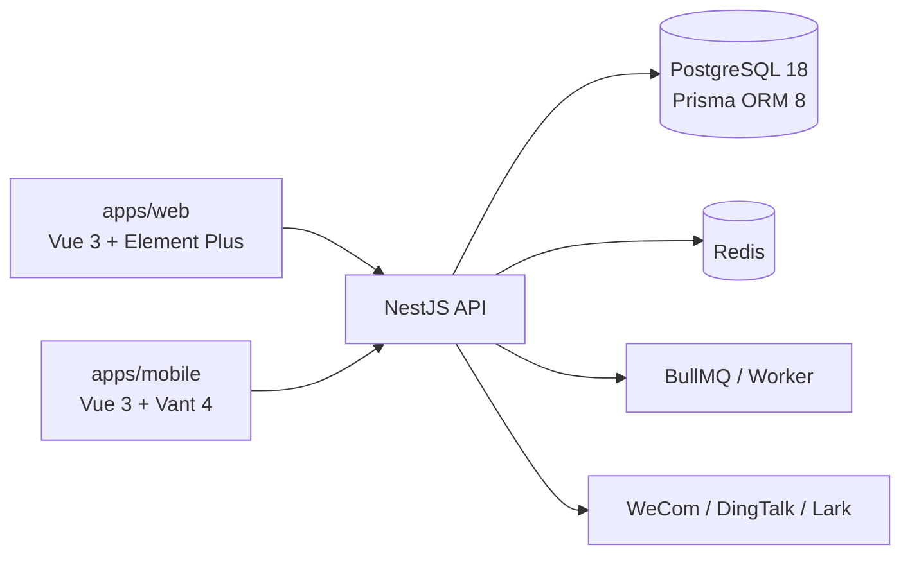

# 招生CRM 系统架构

## 1. 系统边界

招生CRM 是面向招生团队的通用 CRM。核心业务围绕线索获取、分配、跟进、转化客户和客户持续跟进；课程、报名、缴费等具体业务事实由外部业务系统负责，通过受控外部事件同步必要结果。



Monorepo 主要边界：

- `apps/api`：NestJS API、独立 Worker、Prisma ORM 8 runtime。
- `apps/web`：PC 管理端，Vue 3 + Element Plus。
- `apps/mobile`：独立 Mobile H5，Vue 3 + Vant 4 + UnoCSS presetWind4，生产路径 `/mobile/`。
- `packages/shared`：前后端共享 DTO、枚举、权限和纯领域逻辑。
- `packages/frontend-shared`：PC/Mobile 共用的 HTTP、Token、设备判断和浏览器基础能力。
- `packages/migrate`：生产数据库迁移运行时。

## 2. 当前业务域

- **线索**：线索列表、线索池、负责人、判重、跟进超时、导入导出和转客户。不再使用固定系统阶段/状态字段。
- **客户**：客户资料、客户公海、负责人历史、跟进记录、跟进计划和客户完结规则。
- **动态表单**：模块表单、动态字段、数据源、字段联动、唯一性、列表展示和筛选。
- **首页分析**：线索与客户统计、渠道来源、转化趋势、负责人/部门表现及自定义字段分布。
- **外部事件**：API Key 调用、事件模板、目标模块/动作、动态字段映射、幂等 Inbox 和审计。
- **平台能力**：组织、成员、角色权限、通知、公告、日志、企业设置与第三方 Provider 集成。

联系人不再作为独立模块或资源；审批能力保留，但当前不参与招生主流程自动触发。商机、产品、报价、合同、回款、发票、订单和标讯等传统销售交易链不属于当前产品范围。

## 3. 多租户、权限与数据范围

- Tenant 是所有业务数据的首要隔离边界，业务查询必须显式保持租户条件。
- RBAC 功能权限由角色权限并集决定；数据范围只合并真正拥有目标动作权限的角色，避免无关角色扩大可见范围。
- 数据范围支持本人、部门、部门及下级、自定义部门和全部范围；列表、详情、统计、导入导出与写操作都必须执行服务端校验。
- API Key 请求仍进入同一租户、功能权限和 DataScope 边界，不因第三方调用绕过授权。

## 4. 动态表单与数据

模块表单由 Metadata 服务统一管理。固定业务列负责租户、负责人、池归属、关联关系和必要索引；扩展值使用 Field / FieldBlob 保存。字段定义、值校验、唯一性、筛选、附件生命周期、联动和跨表单显式 formLink 由统一 Metadata 能力处理，业务模块不得另建字段协议。

## 5. Lead → Customer

Lead 与 Customer 是独立业务资源。转化建立两者之间的业务关联，并按显式表单链接规则处理跟进记录、跟进计划、附件和动态字段；不创建销售交易资源。

## 6. 外部事件

外部系统使用 API Key 调用已启用的事件模板。模板限定目标模块、动作、匹配条件和字段映射；服务端重新校验权限、数据范围、表单字段和唯一资源定位。Inbox 用于幂等控制，业务写入、Inbox 成功状态和审计记录在同一事务中提交。

缴费成功同步按学生姓名和手机号检查客户与线索：命中客户则更新客户字段；仅命中未转化线索则转化为客户；均未命中或出现冲突时拒绝执行，不自动创建客户。详细规则见[外部事件文档](./external-events.md)。

## 7. Prisma ORM 8

数据库层采用 Prisma ORM 8 contract/runtime，不使用 Prisma Client class 继承模式。

```text
apps/api/
├── prisma.config.ts
├── migrations/                 # 正式 migration graph
└── src/prisma/
    ├── contract.prisma         # 数据模型唯一事实源
    ├── contract.json           # contract emit 产物
    ├── contract.d.ts           # contract emit 产物
    ├── db.ts                   # 进程级 client 创建点
    └── seed*.ts
```

`db.ts` 是应用运行时唯一 client 创建点；API 与 Worker 各自在独立 Node.js 进程中持有连接池。NestJS Prisma service 负责依赖注入与生命周期管理。结构变更只追加 forward migration，具体规则见 [Prisma Migration 规范](./prisma-migration-policy.md)。

## 8. Redis、通知与异步任务

- PostgreSQL 是业务状态、通知、幂等记录和导出任务的持久化事实源。
- Redis 承载派生缓存、Pub/Sub 实时信号、分布式协调租约和 BullMQ 队列传输信息。
- Redis 缓存或实时信号故障不能改变已提交的业务事实；依赖 BullMQ 的异步导出在队列不可用时必须明确失败。
- BullMQ job 只携带任务标识，导出参数和状态保存在 PostgreSQL；Worker 可根据待处理任务恢复缺失 job。

## 9. 企业集成

企业微信、钉钉和飞书使用统一的企业集成配置边界。凭据加密持久化，不在 API、日志或前端回显明文。组织同步、外部身份和 OAuth 均绑定租户，并执行成员映射、state 一次性消费和防重放校验。

## 10. 生产发布

生产发布使用 API、Migration、Web 三类镜像；Worker 复用 API 镜像执行 `dist/worker.js`。Web 镜像同时包含 PC `apps/web/dist` 和 Mobile `apps/mobile/dist`。Git Tag workflow 负责构建并推送镜像，不直接更新生产 Compose；部署环境需单独拉取指定版本并重建服务。详见 [Docker 发布文档](./docker-release.md)。

## 11. 工程基线

- Node.js：`>=25 <26`；pnpm：`11.25.0`。
- TypeScript：`7.0.2`；Vue typecheck 使用仓库 `tools/vue-tsc.mjs`。
- API：NestJS 11 + Prisma ORM 8。
- PC：Vue 3 + Vite + Element Plus。
- Mobile：Vue 3 + Vite + Vant 4 + UnoCSS presetWind4。
- 提交前按改动范围执行 typecheck、测试、build、ESLint 和 `git diff --check`。

## 12. 安全基线

- 除显式 `@Public` 路由外，API 统一经过认证与权限校验。
- JWT 与 API Key 都必须进入 tenant、功能权限和数据范围检查。
- 密码使用 bcrypt；禁用密码登录的账号不得通过密码登录或修改密码入口绕过限制。
- 企业集成 Secret 使用项目统一加密边界，不允许日志或接口回显明文。
- Webhook、外部 URL 和 Provider 请求遵守现有 SSRF、Header 与错误分类约束。
